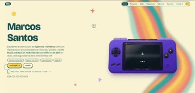

# Marcos Santos · Portfolio Interactivo (GBA Retro Edition)

[](https://developer.mozilla.org/es/docs/Web/HTML)
[](https://developer.mozilla.org/es/docs/Web/CSS)
[](https://developer.mozilla.org/es/docs/Web/JavaScript)
[](https://developer.mozilla.org/en-US/docs/Web/API/Web_Audio_API)
[-success?style=flat-square)](#)
[](LICENSE)

> Portfolio personal interactivo inspirado en la estética retro de la **Game Boy Advance** y las tardes de videojuegos portátiles. Desarrollado con tecnologías web puras (Vanilla Web), sin dependencias ni frameworks pesados, con foco en el rendimiento, la accesibilidad y el cuidado de los detalles.

🌐 **Demo en vivo:** [https://marcossauah.github.io/](https://marcossauah.github.io/)

---

<p align="center">
  
</p>

---

## 🎮 Características Destacadas

* **Consola portátil interactiva**: Navegación fluida de proyectos simulando cartuchos intercambiables. Cuenta con controles funcionales (D-Pad, hombreras L/R, botones A/B, START, SELECT), animación de inserción/expulsión física y botón de expulsión.
* **Sintetizador de sonido con Web Audio API**: Efectos de audio retro (inserción de cartucho, encendido de consola, clic de botones, escaneo de cámara) sintetizados en tiempo real mediante osciladores, sin necesidad de descargar archivos de audio externos.
* **Modo Videojuego 16-bit (Canvas + Dithering)**: Carrusel polaroid vintage que, al interactuar o hacer hover, ejecuta un escaneo retro y renderiza la fotografía en pixel art mediante un algoritmo de entramado (*Bayer matrix dithering 4x4*) y cuantización de color en un `<canvas>` HTML5.
* **Física y perspectiva 3D**: Inclinación reactiva de la consola (*tilt effect*) y reflejos dinámicos (*glare*) vinculados al movimiento del cursor y al scroll de la página.
* **Ondas retro sinusoidales**: Fondos procedimentales animados en SVG recalculados a 60 FPS mediante `requestAnimationFrame`.
* **Navegación inteligente (Scrollspy)**: Menú superior flotante que detecta y resalta en tiempo real la sección activa según el progreso de lectura del usuario.
* **Casos de estudio técnicos**: Modales nativos (`<dialog>`) con desgloses de arquitectura de software, decisiones de diseño y aprendizajes de proyectos de I+D reales (Correos y ALTEN).
* **Accesibilidad y rendimiento**:
  * Respeto estricto a las preferencias del sistema (`prefers-reduced-motion`).
  * Navegación completa por teclado (`←`, `→`, `Enter`, `Espacio`, `Escape`).
  * Atributos ARIA y estructura semántica HTML5.
  * Formatos de imagen de última generación (`.avif` y `.svg`).
  * Contacto protegido contra *scrapers* de spam para email y teléfono.

---

## 📂 Estructura del Proyecto

Organización limpia y modular para despliegue directo en **GitHub Pages**:

```text
Portfolio/
├── index.html              # Punto de entrada principal y maquetación semántica
├── cv.pdf                  # Curriculum Vitae descargable
├── static/
│   ├── css/
│   │   └── style.css       # Variables CSS, layout responsive y estilos GBA
│   ├── js/
│   │   └── main.js         # Lógica interactiva, Web Audio, canvas pixel art y scrollspy
│   └── images/             # Recursos gráficos optimizados (AVIF, SVG)
│       ├── foto1.avif
│       ├── Logo_ALTEN_Black-1.svg
│       ├── logo-correos.avif
│       └── logo-marchel.avif
├── .gitignore              # Filtro de archivos del sistema y entorno
└── README.md               # Documentación del proyecto
```

---

## 🛠️ Tecnologías Empleadas

* **HTML5 Semántico**: `<main>`, `<section>`, `<nav>`, `<dialog>`, `<canvas>`, `<svg>`.
* **CSS3 Moderno**: CSS Grid, Flexbox, Container Queries (`cqw`), Variables CSS (*Custom Properties*), transformaciones 3D, filtros SVG y animaciones fluidas.
* **JavaScript ES6+**: Asincronía con `Promises`, `requestAnimationFrame`, `IntersectionObserver`, `AudioContext` nativo y manipulación directa del DOM.
* **Tooling**: 100% Vanilla (sin Webpack, Vite, Tailwind ni librerías de terceros).

---

## 🚀 Proyectos Destacados en el Portfolio

1. **Correos Logistics API** *(Beca I+D Correos × UAH)*
   * API core en **FastAPI** para digitalizar la ocupación de casilleros en Unidades de Reparto.
   * Autenticación **JWT** para PDAs Android, colas asíncronas en **Redis** conectadas al servicio de visión artificial (**YOLO**), base de datos **PostgreSQL**, proxy inverso **Nginx** y despliegue multi-contenedor con **Docker Compose**.
2. **ALTEN Mixed Reality LMS** *(Beca I+D ALTEN × UAH)*
   * Portal web docente en **Flask + SQLAlchemy** para el aprendizaje de idiomas en Realidad Mixta (alumnos de 7 a 10 años).
   * Control de acceso basado en roles (RBAC), autenticación corporativa por **LDAP**, control de intentos con **Redis**, batería de 59 tests en **pytest**, base de datos **MariaDB** y contenedorización con **Docker Compose**.
3. **Marchel VoIP PBX** *(Laboratorio de Redes UAH)*
   * Centralita telefónica IP basada en **Asterisk 22** con **PJSIP**, IVR multinivel, conferencias, colas, buzón de voz, síntesis Festival TTS y panel web en **Flask + MariaDB**.
5. **NiKA Distributed Chat** *(Laboratorio de Redes UAH)*
   * Sistema distribuido de mensajería y chat en tiempo real desarrollado junto a Chelsea Fernández Hernández para la asignatura Laboratorio de Redes, Señales y Sistemas (UAH).
   * Arquitectura de bajo nivel con sockets TCP/UDP no bloqueantes y multiplexación I/O sobre `select()` en Python puro (modelos cliente-servidor y P2P híbrido).
   * Evolución a arquitectura web y cloud en tiempo real con Flask, WebSockets, base de datos relacional (Amazon RDS) y procesamiento serverless de facturación en AWS Lambda (código próximamente en GitHub).

---

## 💻 Ejecución en Local

No requiere instalación de paquetes (`npm install` ni `pip install`):

1. Clona el repositorio:

   ```bash
   git clone https://github.com/MarcosSAuah/MarcosSAuah.github.io.git
   cd MarcosSAuah.github.io
   ```

2. Abre `index.html` directamente en tu navegador favorito, o inicia un servidor estático rápido:

   ```bash
   # Con Python 3
   python3 -m http.server 8000

   # O con Node.js (npx)
   npx serve .
   ```

3. Visita `http://localhost:8000` en tu navegador.

---

## 📬 Contacto Profesional

* **Marcos Santos Aragón**
* **Formación**: Estudiante de último curso de Ingeniería Telemática (Universidad de Alcalá).
* **Disponibilidad**: Prácticas curriculares / extracurriculares en Madrid desde **enero/febrero de 2027** (mínimo 450 h, hasta 35 h/semana).
* **Áreas de interés**: Redes, Ciberseguridad, Backend, Infraestructura / DevOps e Inteligencia Artificial.
* **LinkedIn**: [linkedin.com/in/marcos-santos-aragon](https://www.linkedin.com/in/marcos-santos-aragon)
* **GitHub**: [@MarcosSAuah](https://github.com/MarcosSAuah)

---

> **Aviso:** Este portfolio es un proyecto interactivo de carácter exclusivamente personal, educativo y sin fines de lucro inspirado en la estética de las consolas portátiles de principios de los 2000. No existe afiliación, patrocinio ni vinculación comercial con Nintendo Co., Ltd.
